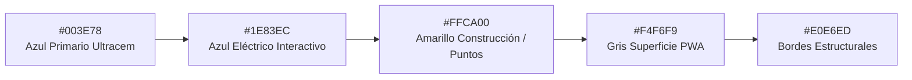
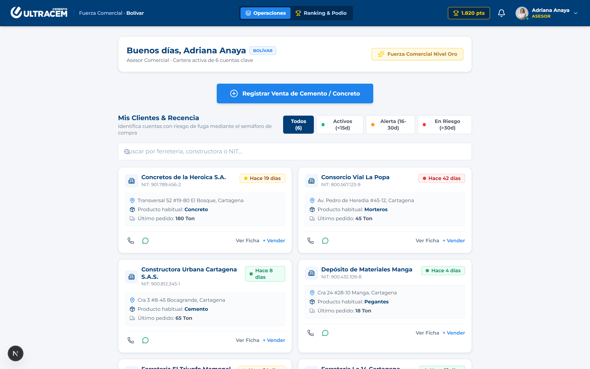
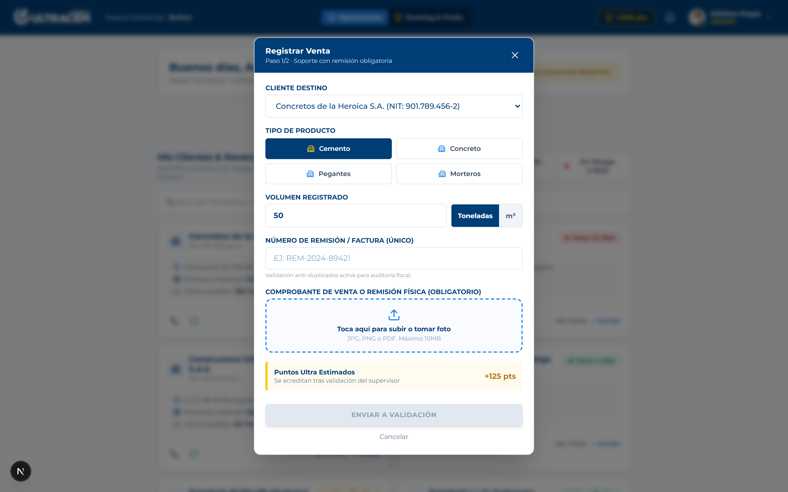
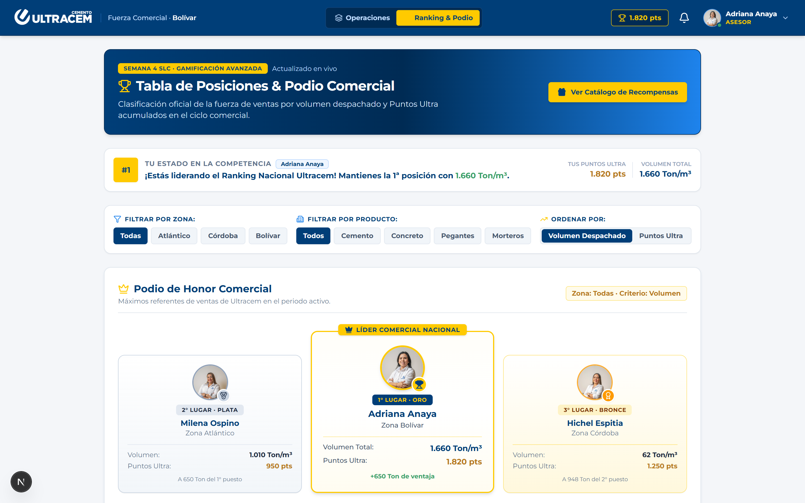
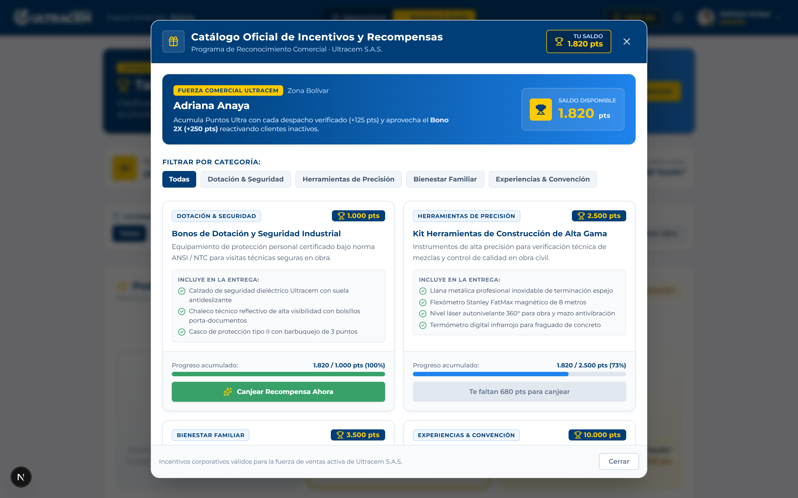
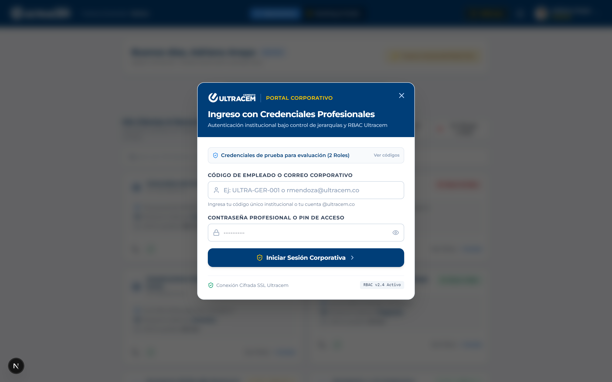
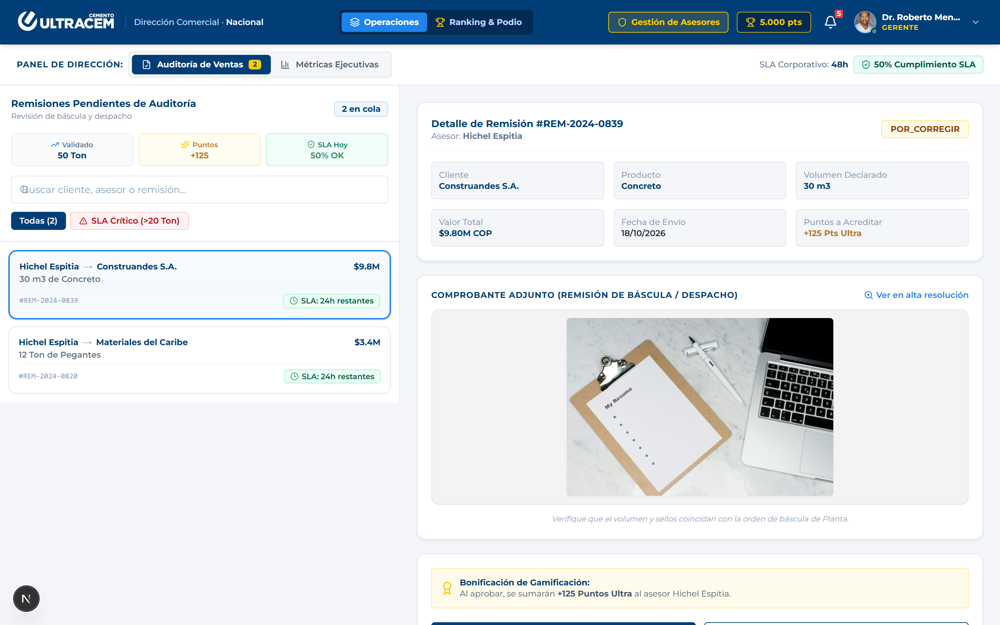
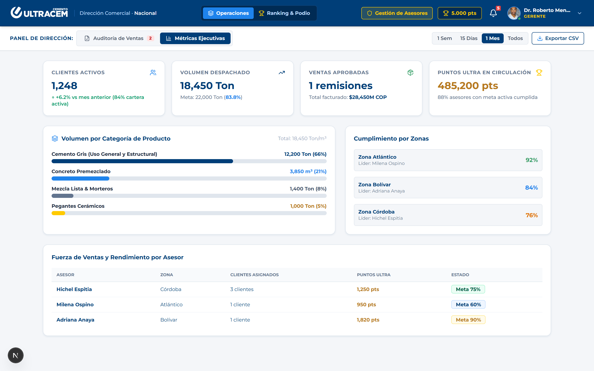
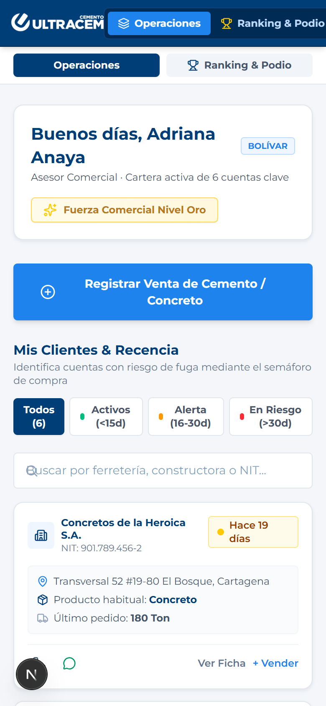

# 🎨 Guía de Marca Oficial & Catálogo de Pantallas — CRM Ultracem

**Cliente:** Ultracem S.A.S. (Barranquilla, Colombia — Operación Costa Caribe)  
**Producto:** Sistema de Diseño & Suite Oficial de Pantallas del CRM Gamificado B2B  
**Versión:** 2.0 (Consolidación de Identidad, 2 Roles & Capturas en Alta Resolución)  
**Fecha de Emisión:** Octubre 2026  

---

## 1. Identidad Visual y Guía de Marca Ultracem

### 1.1. Logotipo Corporativo
El logotipo de Ultracem simboliza solidez industrial, dinamismo en construcción e innovación en materiales pesados:
* **Símbolo / Isotipo:** Ícono circular que evoca la rotación del tambor concretero y la flecha de avance continuo hacia el futuro.
* **Tipografía del Logo:** Tipografía de palo seco en mayúsculas sostenidas con trazos gruesos y contundentes.
* **Versiones de Aplicación:**
  * **Sobre Fondo Corporativo (`#003E78`):** Versión 100% blanco monocromático de alto contraste.
  * **Sobre Fondo Claro (`#FFFFFF` o `#F4F6F9`):** Versión oficial a color con isotipo y tipografía institucional.
* **Zona de Protección:** Espacio mínimo equivalente al 50% de la altura de la letra "U" en todo su contorno.

---

### 1.2. Paleta Cromática Institucional



| Color Visual | Código HEX | Código RGB | Nombre del Color | Función en la Interfaz CRM |
| :---: | :--- | :--- | :--- | :--- |
|  | **`#003E78`** | `rgb(0, 62, 120)` | **Azul Ultracem (Primario)** | Cabeceras, tarjetas de honor, botones primarios, títulos H1/H2 y chips de filtro activos. |
|  | **`#002B54`** | `rgb(0, 43, 84)` | **Azul Marino Profundo** | Bordes de cabecera, hover de botones primarios y contenedores de credencial. |
|  | **`#1E83EC`** | `rgb(30, 131, 236)` | **Azul Eléctrico (Interactivo)** | Botones de acción rápida (+ Registrar Venta), barras de avance, enlaces y estados focus. |
|  | **`#FFCA00`** | `rgb(255, 202, 0)` | **Amarillo Señalización (Acento)** | Badge de Puntos Ultra, coronas del podio comercial, banner offline y bonificaciones. |
|  | **`#F4F6F9`** | `rgb(244, 246, 249)` | **Gris Nieve (Superficie)** | Fondo general de la plataforma PWA, reduciendo el deslumbramiento en terreno. |
|  | **`#E0E6ED`** | `rgb(224, 230, 237)` | **Gris Contorno (Borde)** | Separadores, bordes de tarjetas, inputs de formulario y pistas de progreso. |
|  | **`#38A169`** | `rgb(56, 161, 105)` | **Verde Concreto (Éxito)** | Semáforo de recencia Óptimo (<15d), ventas aprobadas y cumplimiento de metas. |
|  | **`#D97706`** | `rgb(217, 119, 6)` | **Ámbar Preventivo (Alerta)** | Semáforo de recencia Alerta (16-30d) y advertencia preventiva de SLA. |
|  | **`#E53E3E`** | `rgb(229, 62, 62)` | **Rojo Operativo (Crítico)** | Semáforo de recencia Crítico (>30d), causales de rechazo y SLA vencido. |

---

### 1.3. Tipografía Oficial & Escala Jerárquica

* **Familia Principal:** `Inter`, `Montserrat`, `system-ui`, `-apple-system`, `sans-serif`.
* **Familia Numérica / Códigos:** `ui-monospace`, `SFMono-Regular`, `Menlo`, `monospace` para números de remisión, NITs y códigos de empleado.

```
H1 Principal (24px, Bold, #003E78)
├── H2 Sección (18px, Bold, #003E78)
│   ├── H3 Subtítulo (14px, Bold, #003E78)
│   │   ├── Body Texto (12px, Regular, #4A5568)
│   │   ├── Badges & Pills (10px - 11px, Black, uppercase tracking-wider)
│   │   └── Código Mono (12px, Monospace, #003E78)
```

---

### 1.4. Geometría y Sistema de Esquinas Rectangulares
Por directriz corporativa B2B:
* **Prohibición de Óvalos Informales:** Se eliminó el uso de `rounded-full` en botones de filtro, badges y pills operativas.
* **Estándar Rectangular Corporativo:**
  * **`rounded-[5px]`**: Para botones de acción principal, chips de filtrado territorial, pestañas de navegación y tarjetas de incentivo.
  * **`rounded-[4px]`**: Para micro-badges de recencia, tags de producto y selectores temporales compactos.
  * **`rounded-xl` (12px)**: Exclusivo para tarjetas contenedoras principales (`card-ultracem`) y modales estructurados.

---

### 1.5. Iconografía Técnica: Cero Emojis
Se eliminó el 100% de emojis informales, sustituyéndolos por componentes SVG técnicos de `lucide-react`:
* **Reconocimiento & Gamificación:** Trophy, Medal, Award, Crown, Sparkles
* **Logística & Despacho:** Package, Truck, Layers, Building2
* **Operaciones & Auditoría:** CheckCircle2, XCircle, Clock, FileCheck, ShieldCheck
* **Comunicaciones & Seguridad:** Phone, MessageCircle, KeyRound, Shield, LogOut

---

## 2. Catálogo Oficial de Pantallas & Mockups de Dispositivo

A continuación se presentan las 8 pantallas oficiales capturadas directamente de la aplicación activa, montadas con su correspondiente especificación técnica y reglas de negocio:

---

### Pantalla 1: Dashboard Operativo del Asesor Comercial
> **Rol:** `asesor` (Fuerza Comercial Ultracem)  
> **Dispositivo:** Desktop 1440 × 900 / PWA  
> **Objetivo:** Visualización de cuota mensual, semáforo de riesgo de cartera y botón prioritario para registro de despachos.



#### Especificación Técnica & Reglas de Negocio:
* **Cabecera Institucional:** Logotipo `CEMENTO ULTRACEM` en monocromático blanco, navegación persistente `Operaciones` vs `Ranking & Podio`, saldo de `1.250 pts` en contenedor dorado y menú de perfil privado.
* **Barra de Progreso Dinámica:** Monitoreo visual de cuota al 75% (`150 / 200 Ton` de Cemento Gris) con cálculo automático de toneladas faltantes para bonificación.
* **Botón Prominente Central:** `+ Registrar Venta de Cemento / Concreto` en azul interactivo `#1E83EC` con esquinas rectangulares corporativas (`rounded-[5px]`).
* **Filtros de Recencia Armonizados:** Selector uniforme en fondo blanco con micro-indicadores circulares de color nítido para `Activos (<15d)`, `Alerta (16-30d)` y `En Riesgo (>30d)`.

---

### Pantalla 2: Formulario de Despacho & Carga de Tiquete de Báscula
> **Rol:** `asesor` (Fuerza Comercial)  
> **Dispositivo:** Modal Interactivo Desktop / Móvil  
> **Objetivo:** Registro en terreno con evidencia fotográfica obligatoria de báscula de planta.



#### Especificación Técnica & Reglas de Negocio:
* **Conmutación Automática de Unidad:** Al seleccionar Cemento Gris se bloquea en Toneladas (Ton); al seleccionar Concreto Premezclado se conmuta a Metros Cúbicos (m³).
* **Dropzone de Evidencia Obligatoria:** Acepta captura de cámara directa o archivo digital del tiquete de báscula con validación de peso y sellos de Planta Galapa.
* **Estimador de Gamificación:** Informa antes del envío si la venta otorga `+125 Pts` regulares o `+250 Pts (Bono 2X)` si el cliente estaba en estado Crítico (>30d).

---

### Pantalla 3: Tabla de Posiciones & Podio Comercial (Semana 4 SLC)
> **Rol:** Todos los colaboradores (`asesor` y `gerente`)  
> **Dispositivo:** Desktop 1440 × 900 / PWA  
> **Objetivo:** Estimulación competitiva transparente con podio de honor y cálculo motivacional de brecha métrica.



#### Especificación Técnica & Reglas de Negocio:
* **Indicador de Distancia Motivacional:** *"Estás en el Puesto #2 · A solo 140 Ton de alcanzar a Adriana Anaya (Puesto #1)"*.
* **Filtros Estandarizados:** Tanto el filtro por Zona como por Producto comparten el azul institucional `#003E78` cuando están activos.
* **Podio Comercial de Honor:** Pedestales para Puesto 1 (Oro), Puesto 2 (Plata) y Puesto 3 (Bronce).
* **Desglose de Despachos:** Tabla con detalle de toneladas de cemento, metros cúbicos de concreto y puntos acumulados con fila destacada para el usuario logueado.

---

### Pantalla 4: Catálogo Oficial de Incentivos y Recompensas
> **Rol:** `asesor` (Fuerza Comercial)  
> **Dispositivo:** Modal Interactivo Desktop / Móvil  
> **Objetivo:** Canje simulado de Puntos Ultra por artículos de dotación industrial, herramientas técnicas y bienestar familiar con emisión de vouchers.



#### Especificación Técnica & Reglas de Negocio:
* **Saldo Disponible en Vivo:** Banner superior con saldo de Puntos Ultra del usuario y recordatorio del Bono 2X (+250 pts).
* **Filtros por Categoría:** Chips rectangulares (`rounded-[5px]`) para *Dotación & Seguridad*, *Herramientas de Precisión*, *Bienestar Familiar* y *Experiencias & Convención*.
* **Barra de Progreso por Artículo:** Muestra el porcentaje acumulado hacia cada premio y bloquea el botón si el saldo es insuficiente.
* **Generación de Voucher:** Al confirmar el canje, emite un código institucional alfanumérico copiable al portapapeles y descuenta el saldo en la base de datos.

---

### Pantalla 5: Portal de Acceso Institucional (Credenciales Profesionales)
> **Rol:** Todos los usuarios  
> **Dispositivo:** Modal de Ingreso Desktop / Móvil  
> **Objetivo:** Autenticación corporativa bajo jerarquía de 2 roles con protección estricta de contraseñas.



#### Especificación Técnica & Reglas de Negocio:
* **Ingreso Seguro:** Validación mediante código de empleado (`ULTRA-ASE-XXX` o `ULTRA-GER-XXX`) o correo y contraseña profesional.
* **Aislamiento Total:** El entorno de demostración encapsula los códigos de prueba en un acordeón protegido `<details>` para evitar fugas de contraseñas.
* **Conexión Directa a Oracle Cloud:** Valida el estado activo de la cuenta contra el motor PostgreSQL 17.

---

### Pantalla 6: Dirección Comercial — Auditoría y Validación de Remisiones
> **Rol:** `gerente` (Dirección Comercial)  
> **Dispositivo:** Desktop Split-Screen (40% / 60%)  
> **Objetivo:** Mesa de inspección documental cruzada con control de SLA de 48 horas y aprobación en 1 clic.



#### Especificación Técnica & Reglas de Negocio:
* **Panel Izquierdo (40%):** Cola de remisiones con conteo regresivo de SLA, resumen del turno (toneladas validadas, puntos acreditados) y filtro por nivel de urgencia (`Todas` vs `SLA Crítico >20 Ton`).
* **Panel Derecho (60%):** Mesa de inspección con visor del tiquete de báscula en alta resolución, desglose financiero y botones de decisión rápida:
  * **Aprobar Remisión:** Acredita de inmediato los Puntos Ultra al asesor y actualiza la meta del mes.
  * **Rechazar / Solicitar Ajuste:** Despliega formulario obligatorio con 4 causales institucionales y campo de observaciones para corrección.

---

### Pantalla 7: Dirección Comercial — Tablero Ejecutivo de Analítica & Rendimiento
> **Rol:** `gerente` (Dirección Comercial)  
> **Dispositivo:** Desktop 1440 × 900  
> **Objetivo:** Visión global del rendimiento comercial nacional, penetración por categorías de producto y exportación de data a Excel.



#### Especificación Técnica & Reglas de Negocio:
* **4 KPIs Primarios de Alto Impacto:**
  1. Clientes Activos Nacional: `1,248` (+6.2% vs mes anterior).
  2. Volumen Despachado: `18,450 Ton` (83.8% de meta mensual).
  3. Remisiones Validadas: `1,120 operaciones` ($28,450M COP facturados).
  4. Puntos Ultra en Circulación: `485,200 pts` (88% asesores en meta).
* **Desglose de Líneas de Producto:** Cemento Gris (66%), Concreto Premezclado (21%), Morteros (8%), Pegantes Cerámicos (5%).
* **Cumplimiento Territorial por Zonas:** Atlántico (92%), Bolívar (84%), Córdoba (76%).
* **Exportación CSV:** Botón dedicado con codificación `UTF-8 con BOM` para apertura nativa y sin corrupción de tildes en Microsoft Excel.

---

### Pantalla 8: PWA Móvil en Terreno (Vista Smartphone)
> **Rol:** `asesor` (Fuerza Comercial de Campo)  
> **Dispositivo:** Smartphone iPhone 14 (390 × 844 px)  
> **Objetivo:** Operación ergonómica con una sola mano en visitas a pie de obra y ferreterías de periferia.



#### Especificación Técnica & Reglas de Negocio:
* **Ergonomía Táctil Mobile-First:** Botones dimensionados para pulsación rápida con el pulgar.
* **Barra de Navegación Docking Inferior:** Pestañas fijas para acceso rápido a Operaciones y Ranking.
* **Acciones Telefónicas de 1 Toque:** Marcación directa y apertura de chat en WhatsApp sin registrar el número en la agenda del teléfono.
* **Resiliencia Offline-First:** Banner amarillo superior de advertencia en zonas sin cobertura celular con sincronización automática en segundo plano al recuperar señal.
