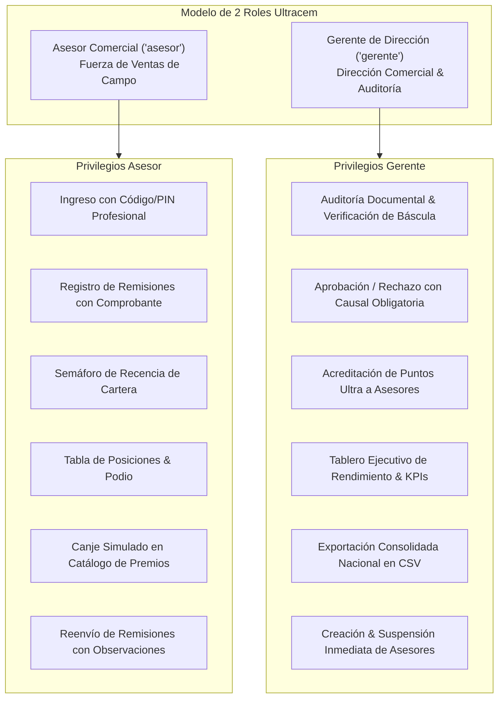
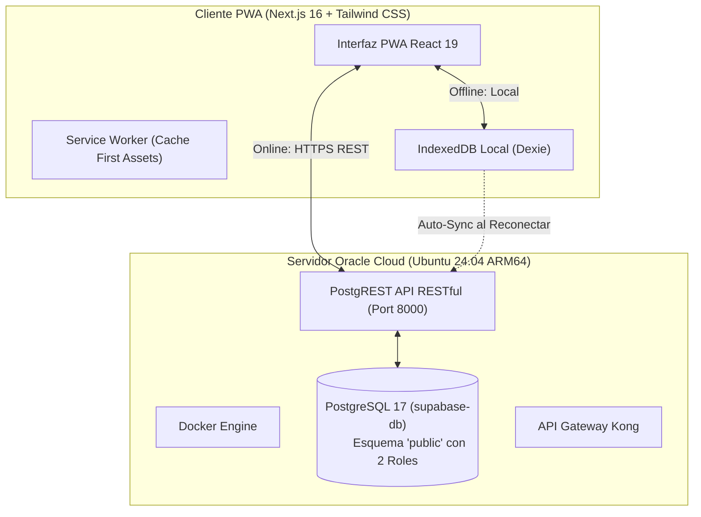

# 📄 Documento de Requisitos de Producto (PRD) — CRM Gamificado Ultracem

**Producto:** CRM Gamificado de Ventas B2B & Progressive Web App (PWA)  
**Cliente:** Ultracem S.A.S. (Barranquilla, Colombia — Operación Costa Caribe)  
**Versión:** 2.0 (Consolidación de 2 Roles & Seguridad Estricta)  
**Fecha de Emisión:** Octubre 2026  
**Enfoque de Entrega:** Estándar SLC (*Simple, Lovable, Complete*)

---

## 1. Resumen Ejecutivo & Contexto del Negocio

Ultracem S.A.S. es una de las principales compañías productoras y comercializadoras de cemento gris, concreto premezclado, morteros y pegantes en la región Caribe colombiana. Su fuerza de ventas opera en campo, visitando ferreterías, constructoras y depósitos de materiales en los departamentos de Atlántico, Bolívar, Córdoba, Cesar, Magdalena y Sucre.

### 1.1. Problema de Negocio
1. **Fuga Silenciosa de Clientes (Churn Inadvertido):** Los asesores comerciales dedican su tiempo a clientes recurrentes y descuidan cuentas que llevan más de 15 o 30 días sin comprar, facilitando la entrada de la competencia.
2. **Brecha de Conectividad en Obra:** Las visitas a ferreterías de periferia o plantas en zonas rurales sufren caídas de señal móvil, impidiendo registrar pedidos en tiempo real.
3. **Falta de Trazabilidad y Validación en Remisiones:** Las ventas reportadas carecían de verificación documental cruzada (tiquete de báscula de planta o factura electrónica), provocando discrepancias de inventario y comisiones erróneas.
4. **Fricción Operativa por Exceso de Roles:** Una estructura jerárquica con supervisores intermedios generaba demoras en la validación y cuellos de botella burocráticos.

### 1.2. Solución Propuesta: CRM Gamificado Ultracem
Una **Progressive Web App (PWA)** instalable en dispositivos móviles y ejecutable en escritorio, orientada a dos perfiles empresariales:
* **Fuerza Comercial (Asesor):** Registro ágil de ventas en campo con foto de comprobante, funcionamiento offline automático, semáforo de recencia de cartera y motivación gamificada con Puntos Ultra.
* **Dirección Comercial (Gerente):** Mesa unificada de auditoría documental (SLA 48h), tablero ejecutivo de cumplimiento por zonas y gobernanza de credenciales profesionales sin fuga de datos.

---

## 2. Matriz de Roles y Gobernanza RBAC (2 Roles Consolidados)

Se consolida la plataforma estrictamente en **dos roles empresariales**:

### 2.1. Reglas Estrictas de Seguridad y Aislamiento de Credenciales
* **Entorno del Asesor Blindado:**
  * El Asesor **no tiene acceso visual ni operativo** a herramientas de creación o edición de usuarios.
  * No existe botón de "Mi Credencial" ni dropdown de cambio rápido de usuario (suplantación eliminada).
  * En el menú de perfil, el Asesor visualiza exclusivamente su propio código de empleado (`ULTRA-ASE-XXX`) y territorio.
* **Ingreso Institucional:**
  * Login mediante código de empleado (`ULTRA-ASE-XXX` o `ULTRA-GER-XXX`) o correo corporativo, con contraseña profesional encriptada.
  * La pantalla de acceso protege las claves; en modo de demostración, se utilizan selectores colapsables protegidos para evaluación técnica.

---

## 3. Especificación Funcional de Módulos

### Módulo 1: Cartera de Clientes & Semáforo de Recencia
* **HU-CLI-01: Semáforo de Riesgo de Abandono (Recency):**
  * 🟢 **Óptimo / Activo:** Última compra realizada hace **menos de 15 días**.
  * 🟡 **Alerta Temprana:** Última compra realizada entre **16 y 30 días**. Requiere contacto proactivo.
  * 🔴 **Crítico / En Riesgo:** Última compra hace **más de 30 días**. Cliente en riesgo inminente de deserción.
* **HU-CLI-02: Filtros Rectangulares de Cartera:**
  * Selector rectangular (`rounded-[5px]`) con microindicador circular: `Todos`, `Activos (<15d)`, `Alerta (16-30d)` y `En Riesgo (>30d)`.
* **HU-CLI-03: Acciones Rápidas en Ficha:**
  * Enlace `tel:` directo para llamada al comprador de la ferretería/obra.
  * Enlace `https://wa.me/` directo con mensaje contextual precargado (*"Buen día, nos comunicamos de Ultracem para consultar su requerimiento de cemento..."*).

### Módulo 2: Registro de Ventas & Evidencia Documental (PWA Terreno)
* **HU-VEN-01: Formulario de Despacho:**
  * Selector de cliente asignado.
  * Línea de producto: Cemento Gris (Uso General / Estructural), Concreto Premezclado, Pegantes Cerámicos, Mezcla Lista / Morteros.
  * Selector de unidad dinámico: **Toneladas (Ton)** para cemento y pegantes, **Metros cúbicos (m³)** para concreto premezclado.
  * Número de remisión obligatorio (ej. `#REM-2024-0847`).
* **HU-VEN-02: Evidencia Obligatoria (Dropzone / Cámara):**
  * Carga obligatoria de comprobante físico (tiquete de báscula de planta o remisión sellada). Formatos permitidos: JPG, PNG, WEBP, PDF (máx. 10 MB).
* **HU-VEN-03: Resiliencia Offline-First (IndexedDB):**
  * Si la PWA pierde conexión en zona rural, la venta se almacena localmente en IndexedDB (`offline_sales`).
  * Al recuperar la señal, el banner amarillo institucional (`#FFCA00`) realiza sincronización bidireccional automática con Oracle Cloud Supabase.

### Módulo 3: Gamificación Avanzada & Ranking SLC (Semana 4)
* **HU-GAM-01: Podio Comercial & Tabla de Posiciones en Tiempo Real:**
  * Clasificación oficial ordenada por Volumen Despachado (Ton/m³) o Puntos Ultra acumulados.
  * Podio con honores visuales: Puesto 1 (Corona de Oro), Puesto 2 (Plata), Puesto 3 (Bronce).
  * Filtro cruzado por Zona (Todas, Atlántico, Bolívar, Córdoba) y por Producto (Todos, Cemento, Concreto, Pegantes, Morteros) con chips rectangulares estandarizados en azul `#003E78`.
* **HU-GAM-02: Indicador Motivacional de Brecha:**
  * Muestra al asesor la distancia exacta para alcanzar o superar al competidor inmediato (*"Estás a 140 Ton de superar a Adriana Anaya en el 1er lugar"*).
* **HU-GAM-03: Multiplicador de Reactivación de Clientes Críticos (Bono 2X):**
  * Registrar una venta verificada a un cliente en semáforo **Crítico (>30 días)** otorga **250 Puntos Ultra** (en lugar de los 125 pts estándar).
* **HU-GAM-04: Catálogo Oficial de Incentivos y Recompensas:**
  * Canje simulado de puntos por artículos reales del sector:
    * *Bonos de Dotación & Seguridad Industrial:* 1,000 pts (Botas dieléctricas, chaleco reflectivo).
    * *Kit de Herramientas de Construcción de Alta Gama:* 2,500 pts (Llana profesional, flexómetro magnético Stanley, nivel láser).
    * *Bono Sodexo Canasta Familiar $500,000 COP:* 3,500 pts.
    * *Pase VIP a la Convención Anual Ultracem Cancún:* 10,000 pts.
  * Emisión de **Voucher Digital** con código alfanumérico único copiable al portapapeles y deducción automática del saldo.

### Módulo 4: Dirección Comercial — Auditoría y Aprobación de Remisiones
* **HU-AUD-01: Bandeja de Auditoría en 2 Columnas (40% / 60%):**
  * *Panel Izquierdo:* Cola de remisiones pendientes filtrable por urgencia (`Todas` vs `SLA Crítico >20 Ton`) con temporizador de cuenta regresiva SLA (48 horas hábiles).
  * *Panel Derecho:* Mesa de inspección con visor de comprobante de báscula en alta resolución, datos completos del cliente, volumen, valor total en COP y puntos calculados.
* **HU-AUD-02: Aprobación en 1 Clic:**
  * Al pulsar *Aprobar Venta*, el estado pasa a `aprobada`, se acreditan los Puntos Ultra al asesor en la base de datos y se dispara notificación push.
* **HU-AUD-03: Rechazo Estructurado:**
  * Si la remisión presenta errores, el Gerente debe seleccionar una causal obligatoria:
    1. Comprobante ilegible o sin sellos visibles de planta.
    2. Discrepancia en volumen reportado vs tiquete de báscula.
    3. Remisión duplicada o ya contabilizada.
    4. Cliente no coincide con la orden de entrega.
  * El estado cambia a `por_corregir`, y la PWA del Asesor habilita el modal de reenvío con observaciones.

### Módulo 5: Dirección Comercial — Tablero Ejecutivo de Analítica & Rendimiento
* **HU-DIR-01: 4 KPIs Primarios de Alto Impacto:**
  1. *Clientes Activos Nacional:* Recuento consolidado y tasa de actividad de cartera (84%).
  2. *Volumen Total Despachado:* Toneladas y m³ facturados vs meta global del período.
  3. *Remisiones Validadas:* Conteo de operaciones aprobadas y monto total en pesos ($28,450M COP).
  4. *Puntos Ultra en Circulación:* Total de incentivos vigentes en la fuerza de ventas.
* **HU-DIR-02: Desglose por Línea de Producto:**
  * Cemento Gris (66%), Concreto Premezclado (21%), Mezcla Lista & Morteros (8%), Pegantes Cerámicos (5%).
* **HU-DIR-03: Cumplimiento Territorial por Zonas:**
  * Monitoreo de cumplimiento porcentual para Atlántico (92%), Bolívar (84%) y Córdoba (76%).
* **HU-DIR-04: Exportación de Reporte Consolidado CSV:**
  * Generación instantánea en el cliente con codificación `UTF-8 con BOM` para compatibilidad nativa con Microsoft Excel, discriminando zona, cliente, producto, volumen, valor y estado.

---

## 4. Requisitos No Funcionales (NFR)

1. **Rendimiento:** Carga inicial de la PWA en menos de **1.8 segundos** bajo redes 4G móviles. Interacciones de filtrado en menos de **50 ms** en memoria.
2. **Disponibilidad Offline:** Service Worker y base de datos local IndexedDB garantizan el 100% de operatividad en campo sin conectividad.
3. **Seguridad y Resguardo:** Credenciales protegidas con hash, aislamiento estricto de vistas según rol autenticado y sanitización de entradas contra inyecciones SQL/XSS.
4. **Diseño Responsivo:** Compatibilidad probada desde pantallas móviles pequeñas (360px de ancho) hasta monitores corporativos Ultra-Wide (1440px+).

---

## 5. Arquitectura Técnica y Stack Tecnológico

* **Frontend:** Next.js 16.4.2 (App Router, Turbopack, React 19).
* **Estilos:** Tailwind CSS v4 con variables CSS corporativas de Ultracem.
* **Iconografía:** `lucide-react` (SVG minimalistas técnicos, cero emojis informales).
* **Base de Datos:** PostgreSQL 17 alojado en Oracle Cloud Infrastructure (IP: `149.130.186.213`).
* **Seguridad:** Constraint `CHECK (role IN ('asesor', 'gerente'))` a nivel de motor SQL.
